 
<!-- =========================================================
     G THEJAS | GITHUB PROFILE README
     GitHub: GThejas19
     ========================================================= -->

 

  

---

## 💫 About Me

<table>
<tr>
<td width="60%" valign="top">

### 👋 Hello, I'm Thejas!

- 🎓 BCA Student
- 🌐 Interested in **Computer Networking**
- 🔐 Passionate about **Cybersecurity**
- 💻 Exploring Linux, Python and networking tools
- 🐍 Developing applications using Python and Flask
- 🤖 Interested in Artificial Intelligence and Machine Learning
- 🚀 Building practical real-world projects
- 🤝 Open to collaboration, internships and learning opportunities

### 🎯 Current Focus

- 📡 Understanding networking fundamentals
- 🛡️ Learning cybersecurity and ethical hacking concepts
- 🐧 Practising Linux and system administration
- 🤖 Developing AI-powered security applications
- 🌐 Building full-stack web applications
- 📚 Improving problem-solving and technical skills

</td>
<td width="40%" align="center" valign="middle">

  

**BUILD • LEARN • GROW**

</td>
</tr>
</table>

---

## 🛠️ Skills & Technologies

### 🌐 Networking

### 🔐 Cybersecurity

### 💻 Programming Languages

### ⚙️ Tools & Frameworks

### 📚 Other Technologies

---

## 🚀 Featured Projects

<table>
<tr>
<td width="50%" valign="top">

### 🛡️ InsiderWatch AI

**AI-Powered Insider Threat Detection & Employee Behaviour Analytics**

A cybersecurity project designed to analyse employee activity patterns and identify potentially suspicious insider behaviour.

**Key Features**

- 📊 Interactive security dashboard
- 👤 Employee behaviour intelligence
- 🔍 Suspicious activity detection
- 🚨 Security alerts and risk assessment
- 📈 Activity analytics and visualisation
- 🕵️ Investigation centre
- 📁 CSV report generation
- 📂 Dataset exploration

**Tech Stack**

Python • Streamlit • Pandas • Plotly • CSV

Project status: Development ongoing

</td>
<td width="50%" valign="top">

### 🛡️ CyberSage AI

**AI-Based Phishing Detection & Threat Analysis**

A cybersecurity application designed to analyse suspicious URLs and messages and identify potential phishing threats.

**Key Features**

- 🤖 Machine learning-based classification
- 🔍 Suspicious URL analysis
- 📩 Message threat detection
- 🚦 Risk assessment
- 📊 Model evaluation
- 👤 User authentication
- 📜 Scan history
- 📁 CSV security reports

**Tech Stack**

Python • Flask • Scikit-learn • SQLite • HTML • CSS

Project status: Development

</td>
</tr>

<tr>
<td width="50%" valign="top">

### 🧳 Smart Travel Planner

**Full-Stack Travel Planning & Expense Management Application**

A web application designed to organise trips, explore destinations and manage travel expenses.

**Key Features**

- 👤 User registration and login
- 🗺️ Interactive destination maps
- 🌦️ Live weather information
- 🧾 Trip expense tracking
- 📊 Interactive charts
- 📄 PDF report generation
- 🗓️ Trip and activity planning

**Tech Stack**

Python • Flask • SQLite • HTML • CSS • JavaScript • Chart.js • Leaflet

Project status: In development

</td>
<td width="50%" valign="top">

### ❤️ Cardiac Arrhythmia Detection

**Machine Learning-Based ECG Classification**

A machine learning project focused on identifying abnormal heart rhythm patterns from ECG data.

**Project Concepts**

- 📊 ECG dataset processing
- 🧹 Data preprocessing
- 🤖 Machine learning classification
- 📈 Model evaluation
- 🔬 Normal and arrhythmia classification

**Tech Stack**

Python • Pandas • NumPy • Matplotlib • Scikit-learn

Academic project

</td>
</tr>

<tr>
<td width="50%" valign="top">

### 🚗 Smart Car & Smart Agriculture System

**IoT-Based Smart Automation Project**

An academic project exploring the use of Internet of Things technology in vehicle automation and agriculture.

**Project Concepts**

- 🚘 Smart vehicle monitoring
- 🌱 Smart agriculture automation
- 📡 Sensor-based monitoring
- ⚙️ IoT-based control systems

**Technology Area**

Internet of Things • Sensors • Embedded Systems

</td>
<td width="50%" valign="top">

### 🤖 JARVIS Voice Assistant

**Python-Based Personal Voice Assistant**

A voice assistant project designed to perform basic computer tasks using speech recognition and text-to-speech.

**Project Concepts**

- 🎤 Speech recognition
- 🔊 Text-to-speech responses
- ⏰ Alarm and scheduled tasks
- 🌐 Web browsing commands
- 🖥️ Basic desktop automation

**Tech Stack**

Python • SpeechRecognition • pyttsx3 • Threading

</td>
</tr>
</table>

---

## 🧠 Cybersecurity & AI Learning

### 🚦 Phishing Risk Assessment

| Risk level | Description |
|---|---|
| 🔴 High | Strong suspicious indicators detected |
| 🟠 Medium | Some suspicious indicators detected |
| 🟢 Low | No configured warning indicators found |

> A low-risk result does not guarantee that a website is safe. HTTPS alone does not prove that a website is legitimate.

### 📊 Machine Learning Evaluation

Cybersecurity and ML projects can be evaluated using:

- **Accuracy:** Overall proportion of correct predictions.
- **Precision:** How many predicted positive cases were correct.
- **Recall:** How many actual positive cases were detected.
- **F1-score:** Balance between precision and recall.

*Actual evaluation metrics should be published only after testing with a suitable labelled dataset.*

---

## 📊 GitHub Stats & Activity

  

  

<!-- GitHub Contribution Activity Graph -->

  

  

<!-- GitHub Trophies: alternative endpoint listed by the project maintainers -->

---

## 🐈‍⬛ Coding Companions

**Keep learning. Keep building. Keep growing.**

---

## 🌐 Connect With Me

  

### 💬 My Motto

> Code today for a better tomorrow.

**Thanks for visiting my profile!**

*Let's build something amazing together.* 🚀

